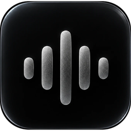

<p align="center">
  
</p>

<h1 align="center">Wave</h1>

<p align="center">
  Desktop music player for YouTube Music and Spotify, with playlist import from Apple Music, YouTube, Spotify and Amazon Music.
</p>

<p align="center">
  <a href="https://github.com/qxmcu/wave/actions/workflows/ci.yml"></a>
  <a href="https://github.com/qxmcu/wave/releases/latest"></a>
  
  <a href="LICENSE"></a>
</p>

| Home                               | Now playing                            | Import                                 |
| ---------------------------------- | -------------------------------------- | -------------------------------------- |
|  |  |  |

## About this fork

Wave is a separate project built from the interface of
[AlgerMusicPlayer](https://github.com/algerkong/AlgerMusicPlayer) by algerkong.
**Only the UI was kept.** AlgerMusicPlayer is a NetEase Cloud Music client;
Wave removes that backend completely and puts its own in its place
([`src/main/wave`](src/main/wave)), which talks to YouTube Music and Spotify.
Accounts, playback, search, lyrics, sync and import are all new code. Bugs in
Wave belong here, not upstream.

## Features

- Search, home feed, charts, artists, albums and radio from YouTube Music
- **Sign in with Google**: YouTube Music playlists and likes sync automatically
- **Sign in with Spotify**: playlists and Liked Songs sync automatically
- Spotify tracks play the same recording from YouTube Music (Spotify does not
  allow third-party apps to stream its audio)
- Import playlists from YouTube, Spotify, Apple Music and Amazon Music links,
  pasted text, or CSV exports
- Time-synced lyrics ([LRCLIB](https://lrclib.net)), desktop lyrics, mini player,
  EQ, downloads, local files

## Install

Download the latest build from [Releases](https://github.com/qxmcu/wave/releases):

- **macOS**: `.dmg` (Apple Silicon `arm64` or Intel `x64`). The app is not
  signed yet: right-click → Open the first time, or run
  `xattr -cr /Applications/Wave.app`.
- **Linux**: `.AppImage`, `.deb` or `.rpm`.

## Development

Requires Node.js 22.

```bash
npm install
npm run dev          # start the app with hot reload
npm test             # unit + API tests
npm run typecheck
npm run build:linux  # or build:mac
```

Spotify sign-in needs a Client ID: see [docs/ACCOUNTS.md](docs/ACCOUNTS.md).
How the backend is put together: [docs/ARCHITECTURE.md](docs/ARCHITECTURE.md).
Contributing: [CONTRIBUTING.md](CONTRIBUTING.md).

## License

[MIT](LICENSE). The original UI is © algerkong (AlgerMusicPlayer, MIT).
## PS
this is a vibecoded project i made for funsies if you like it do use but note that bugs are expected everywhere.
